# Plume

[Version française](README.md)

Select text in any Mac app: a small bar appears and Claude fixes, rephrases, translates or summarizes it. One click to replace the text, another to copy it.




## Features

- **Action bar on any selection**, in every app (Mail, browsers, Slack, Notes, Jira...), with hover tooltips.
- **Built-in actions**: Ask Claude (free-form instruction), Fix, Rephrase, Translate, Summarize, Shorten.
- **Custom actions**: add your own ("Professional tone", "Polite reply"...), pick the icon, instruction and order.
- **Highlighted corrections**, word by word, and a clear confirmation when there is nothing to fix.
- **Result panel**: Replace (⌘↩), Copy as plain text (⇧⌘C), Retry, ask a follow-up ("more formal"...). Esc closes it.
- **Global keyboard shortcut** (⌃⌥C by default) to open the bar on the current selection.
- **Personal instructions** added to every request (spelling variant, typography...).
- **Excluded apps**, model choice (Haiku, Sonnet, Opus), English or French interface.
- **Automatic updates** from GitHub releases.

## Requirements

- macOS 13 or later (Apple Silicon or Intel).
- Access to Claude, either:
  - [Claude Code](https://claude.com/claude-code) installed and signed in: Plume uses it with your subscription, no API key needed;
  - or an **Anthropic API key** ([console.anthropic.com](https://console.anthropic.com/settings/keys)), entered in Settings and stored in the macOS Keychain (pay as you go).

## Install

**Terminal (recommended):**

```bash
curl -fsSL https://raw.githubusercontent.com/gonzalt03/plume/main/install.sh | bash
```

**Homebrew:**

```bash
brew tap gonzalt03/tap
brew trust gonzalt03/tap   # Homebrew asks you to trust third-party taps
brew install --cask plume
```

**DMG:** download the `.dmg` from the [latest release](https://github.com/gonzalt03/plume/releases/latest), open it and drag Plume onto Applications. Plume is not notarized by Apple: on first launch macOS says it "could not verify Plume is free of malware". Close the message, then go to **System Settings > Privacy & Security > Open Anyway**.

Then allow Plume in **System Settings > Privacy & Security > Accessibility** (needed to read the selection and paste the result).

## Updates

Plume checks GitHub releases at launch and every 24 hours. When a new version is out, it offers **Install and Relaunch**, the menu bar icon gets a **dot**, and the menu shows **Install Plume x.y…**. Manual check: Plume menu > **Check for Updates…**. To get GitHub notifications too: **Watch > Custom > Releases** on this repository.

## Privacy

Selected text is sent to Claude only when you click an action. Plume collects nothing else and has no server: requests go straight from your Mac to Claude Code or the Anthropic API. Local diagnostic log: `~/Library/Logs/Plume.log`.

## Contributing

Building from source, releasing and code layout: see [CONTRIBUTING.md](CONTRIBUTING.md) (in French).
