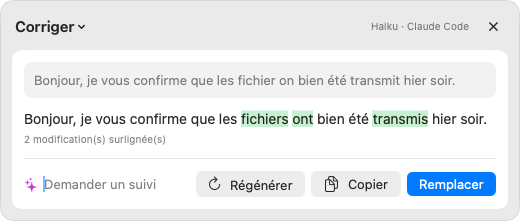
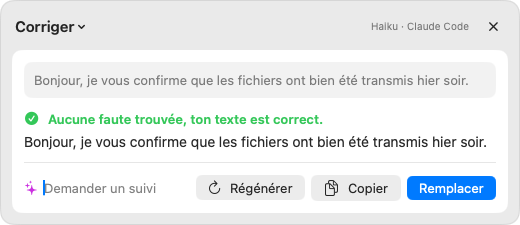
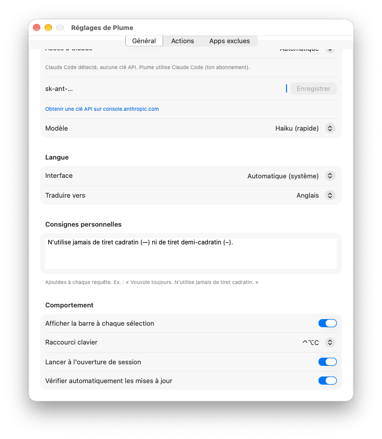

# Plume

[English version](README.en.md)

Sélectionne du texte dans n'importe quelle app du Mac : une petite barre apparaît et Claude le corrige, le reformule, le traduit ou le résume. Un clic pour remplacer le texte, un autre pour le copier.




## Aperçu

| Barre sur la sélection | Corrections surlignées | Aucune faute |
|---|---|---|
|  |  |  |



## Fonctionnalités

- **Barre d'actions sur la sélection**, dans toutes les apps (Mail, navigateur, Slack, Notes, Jira...), avec une bulle d'aide au survol.
- **Actions prêtes à l'emploi** : Demander à Claude (consigne libre), Corriger, Reformuler, Traduire, Résumer, Raccourcir.
- **Actions personnalisables** : ajoute les tiennes (« Ton pro », « Réponse polie »...), choisis l'icône, la consigne et l'ordre.
- **Corrections surlignées** mot à mot, et confirmation claire quand il n'y a aucune faute.
- **Panneau de résultat** : Remplacer (⌘↩), Copier en texte brut (⇧⌘C), Régénérer, demander un suivi (« plus formel »...). Échap ferme.
- **Raccourci clavier global** (⌃⌥C par défaut) pour ouvrir la barre sur la sélection courante.
- **Consignes personnelles** ajoutées à chaque requête (vouvoiement, typographie...).
- **Apps exclues**, choix du modèle (Haiku, Sonnet, Opus), interface en français ou en anglais.
- **Mises à jour automatiques** depuis les releases GitHub.

## Prérequis

- macOS 13 ou plus récent (Apple Silicon ou Intel).
- Un accès à Claude, au choix :
  - [Claude Code](https://claude.com/claude-code) installé et connecté : Plume l'utilise avec ton abonnement, sans clé API ;
  - ou une **clé API Anthropic** ([console.anthropic.com](https://console.anthropic.com/settings/keys)), saisie dans les réglages et stockée dans le trousseau macOS (facturation à l'usage).

## Installation

**Terminal (recommandé) :**

```bash
curl -fsSL https://raw.githubusercontent.com/gonzalt03/plume/main/install.sh | bash
```

**Homebrew :**

```bash
brew tap gonzalt03/tap
brew trust gonzalt03/tap   # Homebrew demande de faire confiance aux taps tiers
brew install --cask plume
```

**DMG :** télécharger le `.dmg` de la [dernière release](https://github.com/gonzalt03/plume/releases/latest), l'ouvrir et glisser Plume sur Applications. Plume n'est pas notariée par Apple : au premier lancement, macOS affiche « Apple n'a pas pu confirmer que Plume ne contenait pas de logiciel malveillant ». Fermer le message, puis **Réglages Système > Confidentialité et sécurité > Ouvrir quand même**.

Dans tous les cas, autoriser ensuite Plume dans **Réglages Système > Confidentialité et sécurité > Accessibilité** (nécessaire pour lire la sélection et coller le résultat).

## Mises à jour

Plume vérifie les releases GitHub au lancement puis toutes les 24 h. Quand une nouvelle version existe :

- une fenêtre propose **Installer et relancer**, **Plus tard** ou **Ignorer cette version** ;
- l'icône de la barre des menus porte une **pastille**, et le menu affiche **Installer Plume x.y…**.

Vérification manuelle : menu Plume > **Rechercher les mises à jour…**. Pour être aussi prévenu par GitHub : bouton **Watch > Custom > Releases** sur ce dépôt.

## Confidentialité

Le texte sélectionné n'est envoyé à Claude que lorsque tu cliques sur une action. Plume ne collecte rien d'autre et n'a aucun serveur : les requêtes partent directement de ton Mac vers Claude Code ou l'API Anthropic. Journal de diagnostic local : `~/Library/Logs/Plume.log`.

## Contribuer

Compilation depuis les sources, publication et structure du code : voir [CONTRIBUTING.md](CONTRIBUTING.md).
